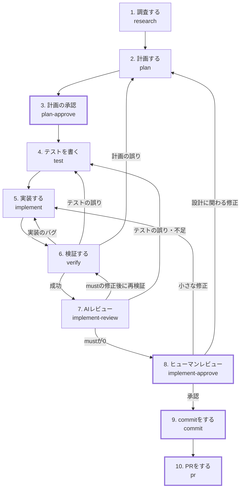

# Agent-Workflow

## 前提

- AI Slopを発生させないように、重要なレビューは人が行うため、commitやPRは人が行う

## Skills

| Skills | Description |
| --- | --- |
| research | 調査をする |
| plan | 計画をする |
| plan-approve | 計画をすり合わせて承認する |
| test | テストを書く |
| implement | 実装する |
| verify | 検証する |
| implement-review | 実装をレビューする |
| implement-approve | 実装を人がレビューする |
| commit | commitの下準備をする |
| pr | PRの下準備をする |

## SubAgents

| SubAgents | Description |
| --- | --- |
| researcher | 調査をする |
| planner | 計画をする |
| plan-reviewer | 計画をレビューする |
| test-writer | テストを書く |
| implementer | 実装する |
| verifier | 検証する |
| implement-reviewer | 実装をレビューする |

## Hooks

| Event | 対象 | Description |
| --- | --- | --- |
| PreToolUse | implementer | テストコードの編集をブロックする |
| PreToolUse | すべて | git commit / git push / gh pr create をブロックする |

## work

ワークフローの中間成果物は `work/` に保存する。

- `work/` はcommitしない（`.gitignore` に追加する）
- PRがマージされたら、人が `work/` を空にする

## How to use this plugin

### Issue対応ワークフロー

太枠のステップは人が判断・操作を行う。

1. 調査する

   EntryPoint: research
   INPUT: issue番号
   OUTPUT: `work/issue.md`、`work/research.md`
   概要:
     - メインがghでissueを取得し、`work/issue.md` に保存する
     - メインが標準の調査観点からタスクに必要なものを選び、不足があれば追加する
     - 観点ごとにresearcherを並列で起動する
     - researcherは事実のみを根拠（ファイル:行、URL）付きで報告し、解決策は提案しない
     - メインが結果を `research.md` にまとめる。不明点は推測で埋めず、不明点として記録する

2. 計画する

   EntryPoint: plan
   INPUT: `work/issue.md`、`work/research.md`
   OUTPUT: `work/plan.md`、`work/plan-review.md`
   概要:
     - plannerが調査結果をもとに `plan.md` を作成する
       - 完了条件はテストケースとして書く
       - 検証方法（テスト・lint・型チェック・ビルドの実行方法）を書く
     - plannerから質問が返ってきた場合、メインが人に確認し、回答を同じplannerに渡して計画を再開させる
     - plan-reviewerが `plan.md` をレビューし、指摘を must / should / nit に分類する
     - mustの指摘が0になるまで、plannerの修正とplan-reviewerのレビューを繰り返す

3. 計画の承認

   EntryPoint: plan-approve
   INPUT: `work/plan.md`、`work/plan-review.md`
   OUTPUT: `work/plan.md`
   概要:
     - メインが前提・未確定事項・shouldの指摘・設計上の判断ポイントについて、人に1問ずつ確認する
     - 確認の結果を `plan.md` に反映する

4. テストを書く

   EntryPoint: test
   INPUT: `work/plan.md`
   OUTPUT: テストコード
   概要:
     - test-writerが `plan.md` のテストケースからテストを書く
     - すべてのテストが想定どおりの理由で失敗することを確認する

5. 実装する

   EntryPoint: implement
   INPUT: `work/plan.md`、テストコード
   OUTPUT: コードの変更、`work/implement.md`
   概要:
     - implementerがテストを1件ずつ Green → Refactor で通す
     - 計画からの小さなずれは、理由とともに `implement.md` に記録して続行する
     - 設計や方針が変わるずれや、テスト自体の誤りに気づいた場合は、作業を止めてメインに質問を返す
     - メインがテストコードに変更がないことを確認する

6. 検証する

   EntryPoint: verify
   INPUT: `work/plan.md`
   OUTPUT: `work/verify.md`
   概要:
     - verifierが `plan.md` の検証方法に従い、テスト全体・lint・型チェック・ビルドを実行する
     - verifierが `plan.md` のテストケースがすべて実装され、通っていることを確認する
     - verifierはコードを修正せず、結果の要約を返す
     - 失敗した場合、メインが原因に応じて実装・テスト・計画のいずれかに戻る
     - AIで確認できない完了条件は、ヒューマンレビューでの確認事項として記録する

7. AIレビュー

   EntryPoint: implement-review
   INPUT: `work/issue.md`、`work/plan.md`、`work/implement.md`、差分
   OUTPUT: `work/implement-review.md`
   概要:
     - implement-reviewerが差分をレビューし、指摘を must / should / nit に分類する
     - mustの指摘はimplementerが修正し、verifierが再検証したうえで再レビューする
     - mustの指摘が0になるまで繰り返す
     - テストの誤りや不足に関する指摘は、人に確認したうえで 4. テストを書く に戻る

8. ヒューマンレビュー

   EntryPoint: implement-approve
   INPUT: 差分、`work/plan.md`、`work/implement.md`、`work/implement-review.md`、`work/verify.md`
   概要:
     - メインが手動で確認すべき事項を示す
     - メインが1ファイルずつ変更を説明し、人の質問が終わってから次のファイルに進む
       - 変更箇所（ファイル名と行番号）、変更前後の違い、変更理由を示す
       - 変更理由は `plan.md` または `implement.md` を根拠とし、根拠がなければ計画外の変更として明示する
       - そのファイルに関するshouldの指摘と計画からのずれは、説明の中で人に確認する
     - 修正が必要な場合、小さな修正は 5. 実装する に、設計に関わる修正は 2. 計画する に戻る

9. commitをする

   EntryPoint: commit
   INPUT: 差分、`work/issue.md`、`work/plan.md`
   概要:
     - メインがcommitの分け方と、各commitのメッセージ案を示す
     - メインが `work/` がcommit対象に含まれていないこと、最後の修正後に検証を通過していることを確認する
     - 人がcommitする

10. PRをする

   EntryPoint: pr
   INPUT: `work/issue.md`、`work/plan.md`、`work/implement.md`、`work/implement-review.md`、`work/verify.md`
   OUTPUT: `work/pr.md`
   概要:
     - メインがPRのタイトルと本文の案を `pr.md` に書く
       - リポジトリにPRテンプレートがあれば、その形式に従う
     - 人がpushし、`pr.md` を確認・修正してPRを作成する

### PR指摘対応ワークフロー

### CI失敗対応ワークフロー
