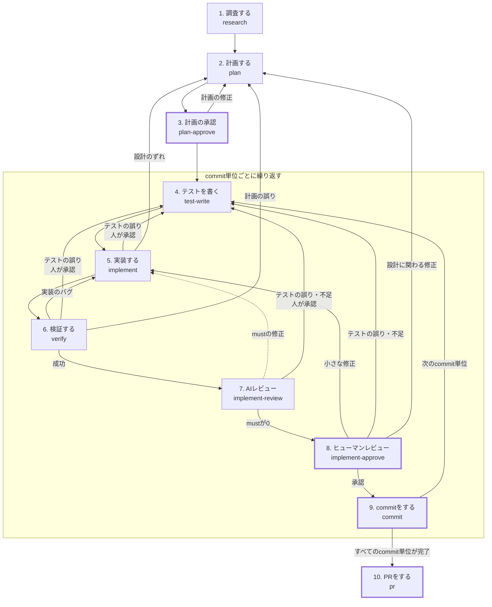

# Agent-Workflow

## 前提

- AI Slopを発生させないように、重要なレビューは人が行うため、commitやPRは人が行う

## Skills

| Skills | Description |
| --- | --- |
| research | 調査をする |
| plan | 計画をする |
| plan-approve | 計画をすり合わせて承認する |
| test-write | テストを書く |
| implement | 実装する |
| verify | 検証する |
| implement-review | 実装をレビューする |
| implement-approve | ヒューマンレビューをする |
| commit | commitの下準備をする |
| pr | PRの下準備をする |

## SubAgents

| SubAgents | Description |
| --- | --- |
| researcher | 調査をする |
| planner | 計画をする |
| plan-reviewer | 計画をレビューする |
| test-writer | テストを書く |
| implementer | 実装する |
| verifier | 検証する |
| implement-reviewer | 実装をレビューする |

## Hooks

| Event | 対象 | Description |
| --- | --- | --- |
| PreToolUse | implementer | テストコードの編集をブロックする |
| PreToolUse | すべて | git commit / git push / gh pr create をブロックする |

## work

ワークフローの中間成果物は `work/` に保存する。

- `work/` はcommitしない（`.gitignore` に追加する）
- 4〜9の成果物は、commit単位ごとに見出しを分けて追記する
- PRがマージされたら、人が `work/` を空にする

## How to use this plugin

### Issue対応ワークフロー

太枠のステップは人が判断・操作を行う。点線はスキル内部で自動的に行う戻りを表す。
4〜9は `plan.md` のcommit単位ごとに繰り返し、1つのcommitごとにレビューしてからcommitする。現在のcommit単位は `plan.md` の「進捗」欄で判断する。
スキルをまたぐ差し戻しは、メインが原因と戻り先を提案し、人が該当するスキルを起動する。
各ステップの「差分」は、HEADに対する作業ツリー全体（untrackedのファイルを含み、`work/` を除く）を指す。

1. 調査する

   - EntryPoint: research
   - INPUT: issue番号
   - OUTPUT: `work/issue.md`、`work/research.md`
   - 概要:
     - メインがghでissueを取得し、`work/issue.md` に保存する
     - メインが標準の調査観点からタスクに必要なものを選び、不足があれば追加する
       - リポジトリのコントリビューション規約（CONTRIBUTING、コミット規約、DCO/CLA）は必ず調べる
     - 観点ごとにresearcherを並列で起動する
     - researcherは事実のみを根拠（ファイル:行、URL）付きで報告し、解決策は提案しない
     - メインが結果を `research.md` にまとめる。不明点は推測で埋めず、不明点として記録する

2. 計画する

   - EntryPoint: plan
   - INPUT: `work/issue.md`、`work/research.md`
   - OUTPUT: `work/plan.md`、`work/plan-review.md`
   - 概要:
     - plannerが調査結果をもとに `plan.md` を作成する
       - 作業をcommit単位に分割し、単位ごとの状態を記録する「進捗」欄を設ける
       - 完了条件はテストケースとして書き、commit単位ごとに割り当てる
       - commit単位ごとに「新規テスト（Redを確認）」か「既存テストで担保」かを決める
       - 検証方法（テスト・lint・型チェック・ビルドの実行方法）を書く
       - 「承認済み決定事項」は変更しない
     - plannerから質問が返ってきた場合、メインが人に確認し、回答を同じplannerに渡して計画を再開させる
     - plan-reviewerが `plan.md` をレビューし、指摘を must / should / nit に分類する
     - mustの指摘が0になるまで、plannerの修正とplan-reviewerのレビューを繰り返す
       - 往復は最大5回まで。超えた場合は残りの指摘を人に渡す
     - commit単位の途中で計画に戻った場合
       - 計画の見直しは、未commitの単位だけを対象にする
       - 「承認済み決定事項」と衝突する場合、plannerは質問として返し、3. 計画の承認 で人が更新する
       - 作業途中の変更の扱い（破棄・保持）は、メインが提案し人が選ぶ

3. 計画の承認

   - EntryPoint: plan-approve
   - INPUT: `work/plan.md`、`work/plan-review.md`
   - OUTPUT: `work/plan.md`
   - 概要:
     - メインが前提・未確定事項・shouldの指摘・設計上の判断ポイントについて、人に1問ずつ確認する
     - メインがcommit単位の分け方と、各単位のテストケースの一覧を示し、人に確認する
     - 確認の結果を `plan.md` の「承認済み決定事項」に記録する
     - 計画の修正が必要な場合は 2. 計画する に戻る

4. テストを書く

   - EntryPoint: test-write
   - INPUT: `work/plan.md`
   - OUTPUT: テストコード、`work/test-write.md`
   - 概要:
     - test-writerが `plan.md` の現在のcommit単位のテストケースからテストを書く
     - 追加・変更したテストが想定どおりの理由で失敗することを確認する
       - Redを確認できない場合は、その理由を `test-write.md` に記録する
     - テストファイルの一覧、テストケースとの対応、想定した失敗理由を `test-write.md` に記録する
     - メインがテストファイルのハッシュを `test-write.md` に記録し、テストコードの基準点とする
     - 基準点の作成後にテストを変更する場合は、メインが変更内容と理由を人に示して承認を得て、変更履歴と新しいハッシュを `test-write.md` に記録する

5. 実装する

   - EntryPoint: implement
   - INPUT: `work/plan.md`、`work/test-write.md`、テストコード
   - OUTPUT: コードの変更、`work/implement.md`
   - 概要:
     - implementerがテストを1件ずつ Green → Refactor で通す
     - 計画からの小さなずれは、理由とともに `implement.md` に記録して続行する
     - 設計や方針が変わるずれや、テスト自体の誤りに気づいた場合は、作業を止めてメインに質問を返す
     - メインがテストファイルのハッシュを基準点と照合し、テストコードが変更されていないことを確認する

6. 検証する

   - EntryPoint: verify
   - INPUT: `work/plan.md`、`work/test-write.md`
   - OUTPUT: `work/verify.md`
   - 概要:
     - verifierが `plan.md` の検証方法に従い、テスト全体・lint・型チェック・ビルドを実行する
     - verifierが現在のcommit単位のテストケースがすべて実装され、通っていることを確認する
     - verifierはコードを修正せず、結果の要約を返す
     - 検証した時点の差分のハッシュを `verify.md` に記録する
     - 失敗した場合、メインが原因に応じて実装・テスト・計画のいずれかへの戻りを提案する
     - AIで確認できない完了条件は、ヒューマンレビューでの確認事項として記録する

7. AIレビュー

   - EntryPoint: implement-review
   - INPUT: `work/issue.md`、`work/plan.md`、`work/test-write.md`、`work/implement.md`、`work/verify.md`、差分
   - OUTPUT: `work/implement-review.md`
   - 概要:
     - implement-reviewerが差分をレビューし、指摘を must / should / nit に分類する
     - mustの指摘はimplementerが修正し、メインがテストコードが基準点から変更されていないことを確認する
     - verifierが再検証したうえで再レビューする
     - mustの指摘が0になるまで繰り返す
       - 往復は最大5回まで。超えた場合は残りの指摘を人に渡す
     - テストの誤りや不足に関する指摘は、人に確認したうえで 4. テストを書く に戻る

8. ヒューマンレビュー

   - EntryPoint: implement-approve
   - INPUT: 差分、`work/plan.md`、`work/test-write.md`、`work/implement.md`、`work/implement-review.md`、`work/verify.md`
   - 概要:
     - メインが手動で確認すべき事項を示す
     - 基準点の作成後にテストが変更されていれば、メインがその変更履歴を示す
     - メインが1ファイルずつ変更を説明し、人の質問が終わってから次のファイルに進む
       - 変更箇所（ファイル名と行番号）、変更前後の違い、変更理由を示す
       - 変更理由は `plan.md` または `implement.md` を根拠とし、根拠がなければ計画外の変更として明示する
       - そのファイルに関するshouldの指摘と計画からのずれは、説明の中で人に確認する
     - 修正が必要な場合、小さな修正は 5. 実装する に、テストの誤り・不足は 4. テストを書く に、設計に関わる修正は 2. 計画する に戻る
     - 修正後に再びヒューマンレビューを行う場合は、前回のヒューマンレビュー以降の差分だけを説明する

9. commitをする

   - EntryPoint: commit
   - INPUT: 差分、`work/issue.md`、`work/research.md`、`work/plan.md`、`work/verify.md`
   - 概要:
     - メインが `plan.md` の現在のcommit単位をもとに、リポジトリのコミット規約に従ったcommitメッセージ案を示す
     - メインが差分全体をstageし、`work/` が含まれていないことを確認する
     - メインがstageした内容のハッシュと `verify.md` のハッシュを照合し、検証済みの内容と一致することを確認する
     - メインが人の実行するcommitコマンドを示す
     - 人がcommitする
     - メインが `plan.md` の「進捗」欄に、commit単位の完了とcommitのSHAを記録する
     - 次のステップ（4. テストを書く または 10. PRをする）の開始時に、メインがcommitされた内容と `verify.md` のハッシュが一致することを確認する
     - 残りのcommit単位があれば 4. テストを書く に戻る

10. PRをする

   - EntryPoint: pr
   - INPUT: commit履歴、ブランチ全体の差分、`work/issue.md`、`work/plan.md`、`work/implement.md`、`work/implement-review.md`、`work/verify.md`
   - OUTPUT: `work/pr.md`
   - 概要:
     - implement-reviewerがブランチ全体の差分をレビューし、commit単位をまたぐ不整合がないこと、issueが解決されていることを確認する
     - 人が全体レビューの結果を確認する。修正が必要な場合は、メインが戻り先を提案する
     - メインがPRのタイトルと本文の案を `pr.md` に書く
       - リポジトリにPRテンプレートがあれば、その形式に従う
     - 人がpushし、`pr.md` を確認・修正してPRを作成する

### PR指摘対応ワークフロー

### CI失敗対応ワークフロー
